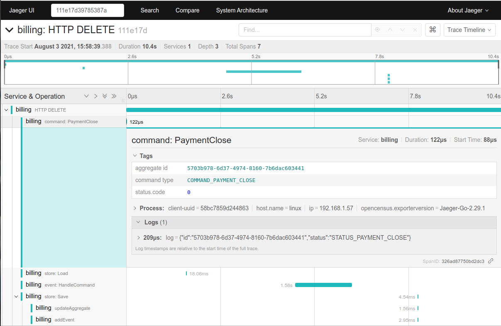

### event-sourcing

This is a simple event sourcing library for Go.

### Feature

- Atomic append with optimistic concurrency
- A generic repository for aggregates
- Snapshots with a policy and schema versions
- Event metadata and upcasters
- A global stream for projections
- OpenTelemetry traces and metrics, declared in
  [`semconv/registry/eventsourcing.yaml`](../semconv/registry/eventsourcing.yaml)
- Store engine
  - PostgreSQL

There is no event bus: publish through a transactional outbox, as below.

##### Repository

`Repository[T]` loads an aggregate from its snapshot and events, and saves its
uncommitted events. An aggregate embeds `BaseAggregate` and implements
`ApplyChange` and `HandleCommand`:

```go
store, err := es_postgres.New(ctx, db)
if err != nil {
	return err
}

orders, err := eventsourcing.NewRepository(store, "order", func() *Order { return &Order{} })
if err != nil {
	return err
}

order, err := orders.Load(ctx, id)
if err != nil {
	return err
}

// apply new events with order.ApplyChangeHelper(ctx, order, event, true)

err = orders.Save(ctx, order)
if errors.Is(err, eventsourcing.ErrConcurrencyConflict) {
	// load again and retry the command
}
```

Use `orders.New()` for a new aggregate. `Load` returns `ErrAggregateNotFound` when
it does not exist.

##### Saving events

`Append` is the stream API under the repository. It writes all its events or none,
with one `UPDATE` of the aggregate and batched `INSERT`s, as the versions after
`expectedVersion` (0 for a new aggregate). `Save` does the same for events that
already carry their aggregate id and version, and stays for compatibility.

```go
err := store.Append(ctx, id, 4, events)
if errors.Is(err, eventsourcing.ErrConcurrencyConflict) {
	// the aggregate is not at version 4: reload and retry
}
```

Aggregate ids and event ids must be UUIDs. The store fills in `Id` (UUIDv7),
`CreatedAt` and `SchemaVersion` (1) when they are not set. Timestamps are stored in
UTC with a precision of one second; events are ordered by `version`.

##### Metadata and upcasting

An event carries `CorrelationId`, `CausationId`, `SchemaVersion` and free-form
`Metadata`, where the store adds the W3C `traceparent` of the write when there is a
span. Old events are never rewritten; bring them up to date on load:

```go
upcast := func(ctx context.Context, event *v1.Event) error {
	if event.GetType() == "deposited" && event.GetSchemaVersion() == 1 {
		// rewrite event.Payload to the current schema
	}

	return nil
}

orders, err := eventsourcing.NewRepository(store, "order", newOrder, eventsourcing.WithUpcasters(upcast))
```

##### Transactions

When `ctx` carries a transaction (`uow.WithTx`), `Append`, `Save`, `Load`, `ReadStream`
and `SaveSnapshot` run in it, and committing is up to the caller. This is how events
and an [`outbox`](../outbox) message are written atomically. A conflict aborts that
transaction, so roll it back before retrying.

##### Snapshots

An aggregate implementing `Snapshotter` is restored from its snapshot. There are two
ways to take them:

- `WithSnapshotEvery(n)` makes `Repository.Save` take one whenever the version
  crosses a multiple of `n`. It never fails the save, and is skipped inside a
  transaction.
- A background job calls `GetAggregateWithoutSnapshot`, tuned with
  `WithSnapshotBatchSize` and `WithSnapshotThreshold`, and `Repository.Snapshot` for
  each aggregate it returns.

`SnapshotSchemaVersion` versions the format. `Load` ignores a snapshot of another
version or one that fails to restore, and replays the events. `SaveSnapshot` keeps
the latest schema version, and then the latest aggregate version.

##### Projections

`ReadAll` reads the events of all aggregates in a stable order. Persist the `Cursor`
of the last event handled:

```go
events, err := store.ReadAll(ctx, cursor, 500)
if err != nil {
	return err
}

for _, event := range events {
	// handle the event, then persist event.GetCursor()
}
```

Sequence values are taken before commit, so reading by position alone would skip a
slow transaction. The cursor is a pair of transaction id and position, and an event
becomes visible once every older transaction has ended: nothing lands behind the
cursor, and one long-running transaction anywhere in the database delays the stream.
Delivery is at-least-once when the cursor is persisted after handling.

##### Migrations

`New` applies the schema. With `WithoutMigrations` it does not, for applications
that run without DDL privileges and apply `es_postgres.Migrations()` themselves.
PostgreSQL 13 or newer is required.

Migration `000006` rewrites `events` under an exclusive lock, to give existing rows a
position. Plan a maintenance window for a large table.

##### Tests

The integration tests start PostgreSQL in a container:

```bash
make test MODULE=eventsourcing TAGS=unit,database
```

##### Tracing



##### References

+ [Pattern: Event sourcing](https://microservices.io/patterns/data/event-sourcing.html)
+ [Go - CQRS / Event Sourcing made easy - Go](https://github.com/mishudark/eventhus)
+ [Examples and Tutorials of Event Sourcing in .NET](https://github.com/oskardudycz/EventSourcing.NetCore)
